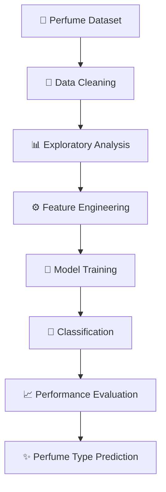

# -Perfume-Type-Classification-12805-Parameter-Mode
# 🧴✨ Perfume Type Classification — 12,805 Parameters Mode

### 🌸 Decode the Scent. Discover the Type. Power It with AI. 🤖

Welcome to **Perfume Type Classification**, a machine learning project designed to explore how artificial intelligence can classify perfume types using data-driven patterns. This project combines the elegance of the fragrance industry with the power of predictive analytics to build a smart and creative classification system.

From fresh and floral fragrances to woody and oriental scent families, the goal is to use machine learning to identify perfume categories based on the features available in the dataset. 🌹💎

---

## 🌟 Project Overview

Perfume is more than just a fragrance — it's a combination of ingredients, personality, and science. This project explores how machine learning can help recognize perfume categories by learning patterns from structured data.

🎯 **Main Objective:** Develop a classification model that predicts perfume types from relevant input features.

🧠 **Model Mode:** 12,805 Parameters Mode  
🧴 **Project Category:** Machine Learning | Classification  
🐍 **Programming Language:** Python  
📊 **Focus Areas:** Data Analysis, Feature Engineering, Model Training, and Evaluation

> ✨ *Turning fragrance data into intelligent predictions, one scent at a time.*

---

## 🚀 Key Features

- 🧹 **Data Preprocessing** — Clean and prepare the dataset for analysis.
- 📊 **Exploratory Data Analysis (EDA)** — Discover patterns and relationships in perfume data.
- 🌸 **Perfume Type Classification** — Predict fragrance categories using machine learning.
- ⚙️ **Feature Engineering** — Prepare useful input features for improved model learning.
- 📈 **Model Evaluation** — Evaluate performance using suitable classification metrics.
- 🎨 **Data Visualization** — Present findings through clear, informative graphs.
- 🔮 **Prediction Pipeline** — Use the trained model to classify new examples.

---

## 🛠️ Technology Stack

| Technology | Purpose |
|---|---|
| 🐍 Python | Core programming |
| 🧮 NumPy | Numerical operations |
| 🐼 Pandas | Data manipulation |
| 📊 Matplotlib | Data visualization |
| 🎨 Seaborn | Statistical charts |
| 🤖 Scikit-learn | Machine learning and evaluation |
| 📓 Jupyter Notebook | Interactive experimentation |

*Use only the libraries that are actually implemented in your project.*

---

## 📊 Visual Analytics & Graphs

Visualizations help reveal the structure of the dataset and the behavior of the classification model.

Recommended graphs to include:

1. 📊 **Perfume Type Distribution** — Compare the number of samples in each class.
2. 🔥 **Feature Correlation Heatmap** — Explore relationships between numerical features.
3. 🎯 **Confusion Matrix** — Analyze correct and incorrect predictions by class.
4. 📈 **Model Performance Comparison** — Compare accuracy, precision, recall, and F1-score.
5. 🌸 **Feature Importance Plot** — Identify influential features when supported by the selected model.

### 📉 Example: Model Evaluation Workflow



*The diagram illustrates the proposed workflow, not measured results from a trained model.*

---

## 🧠 Machine Learning Workflow

**Step 1 — Data Collection 📂**  
Load the perfume dataset and inspect its columns, data types, and target labels.

**Step 2 — Data Preparation 🧹**  
Handle missing values, duplicates, categorical variables, and feature scaling where appropriate.

**Step 3 — Exploratory Data Analysis 🔍**  
Visualize class distributions and investigate which features may help distinguish perfume types.

**Step 4 — Model Training 🤖**  
Split the data into training and testing sets, then train a suitable classification algorithm.

**Step 5 — Evaluation 📈**  
Measure accuracy, precision, recall, and F1-score. Use a confusion matrix to identify classes that need improvement.

**Step 6 — Prediction ✨**  
Apply the trained model to new data using the same preprocessing steps used during training.

---

## 📏 Understanding the 12,805-Parameter Mode

The project title includes **12,805 Parameters Mode**. In machine learning, a parameter usually means a learned model value, such as a weight or bias in a neural network.

If **12,805** refers to the model's actual learned parameters, document the architecture and parameter count to make this claim reproducible. If it refers to dataset rows, configuration settings, or another project-specific quantity, clarify that meaning here.

---

## 📂 Suggested Repository Structure

```text
Perfume-Type-Classification/
│
├── 📓 perfume_classification.ipynb
├── 📁 data/
│   └── perfume_dataset.csv
├── 📁 graphs/
│   ├── class_distribution.png
│   ├── confusion_matrix.png
│   └── feature_importance.png
├── 📁 models/
│   └── trained_model.pkl
├── 📄 requirements.txt
├── 📄 README.md
└── 📄 LICENSE
```

*This is a suggested structure; adjust it to match the files in your repository.*

---

## ▶️ Getting Started

### 1. Clone the Repository

```bash
git clone https://github.com/YOUR-USERNAME/Perfume-Type-Classification.git
cd Perfume-Type-Classification
```

### 2. Install Dependencies

```bash
pip install pandas numpy matplotlib seaborn scikit-learn jupyter
```

### 3. Launch the Notebook

```bash
jupyter notebook
```

Open the project notebook and run the cells in order. Update the dataset path to match your local setup.

---

## 🎯 Applications

- 🛍️ Fragrance catalog organization
- 🧴 Automated perfume categorization
- 📊 Fragrance dataset analysis
- 🤖 Machine learning education and experimentation
- 💡 A foundation for intelligent fragrance recommendation systems

*These are potential applications, not claims of production deployment.*

---

## 🔮 Future Improvements

- 🌐 Build an interactive Streamlit web application.
- 🧠 Experiment with multiple classification algorithms.
- 📈 Tune hyperparameters using cross-validation.
- 🧴 Add a fragrance recommendation feature.
- ☁️ Deploy the trained model as an API.
- 🎨 Create a premium, perfume-inspired user interface.

---

## 👨‍💻 Skills Demonstrated

`Python` · `Machine Learning` · `Classification` · `Pandas` · `NumPy` · `EDA` · `Data Visualization` · `Scikit-learn` · `Model Evaluation`

---

## 💎 Final Thoughts

**Perfume Type Classification** brings together fragrance, data science, and intelligent prediction in one project. It provides a practical opportunity to explore the machine learning lifecycle — from raw data and visual analysis to model training and evaluation.

🌸 Every fragrance tells a story.  
📊 Every dataset reveals a pattern.  
🤖 Every model makes a prediction.

**Let's make fragrance data smarter, one classification at a time!** 🧴✨

---

### 🏷️ Tags & Topics

`#MachineLearning` `#Python` `#PerfumeClassification` `#DataScience` `#ArtificialIntelligence` `#ScikitLearn` `#EDA` `#DataVisualization` `#GitHub` `#MLProjects`
## 📊 Model Performance


## 🌸 Perfume Type Distribution


